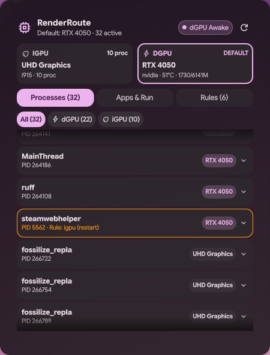
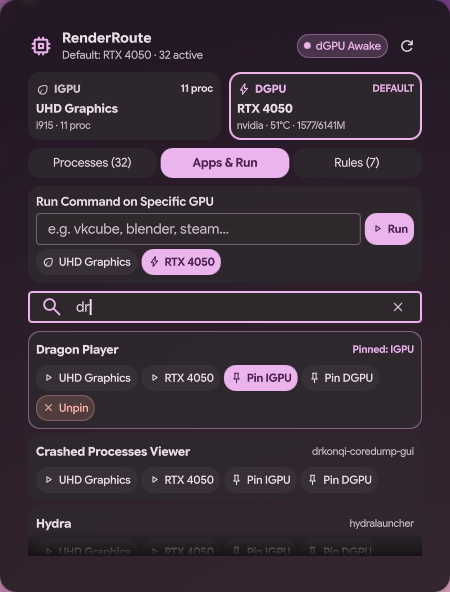
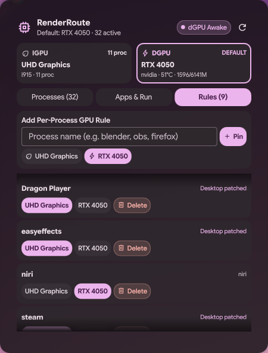

# RenderRoute

**RenderRoute** is a fast, zero-dependency Linux utility for choosing which GPU specific processes and desktop applications use, paired with a native **DankMaterialShell (DMS)** widget plugin (supporting both **DankBar** and **Control Center**).

## Screenshots

| Processes | Apps & Run | Rules |
| :---: | :---: | :---: |
|  |  |  |

## Features

- **Automatic Multi-GPU Discovery** (`/sys/class/drm`, `/dev/dri`, `lspci`, Vulkan ICDs, EGL vendors) with stable PCI-slot identification and automatic `iGPU` / `dGPU` classification.
- **Sleep-Safe Telemetry**: Reads `/sys/class/drm/card*/device/power/runtime_status` first and **never invokes `nvidia-smi` when a laptop dGPU is runtime-suspended** — and the polled `status` command only queries `nvidia-smi` for NVIDIA GPUs that already have active clients, so an idle dGPU is free to autosuspend.
- **Complete Multi-API GPU Routing**: Generates the exact OpenGL/GLX, EGL, Vulkan (`VK_DRIVER_FILES`, `VK_ICD_FILENAMES`, `MESA_VK_DEVICE_SELECT`), PRIME (`__NV_PRIME_RENDER_OFFLOAD`, `DRI_PRIME=pci-...`), VA-API (`LIBVA_DRIVER_NAME`), and CUDA/ROCm environment variables while stripping conflicting variables from other vendors.
- **Live GPU Process Monitor**: Combines `/proc/<pid>/fd`, `/proc/<pid>/fdinfo`, and `nvidia-smi` to show which running processes are bound to which GPU (with VRAM usage and rule-mismatch detection).
- **Per-Process & Per-App Persistent Rules**: Stored in `~/.config/renderroute/config.json`, plus safe user-local `.desktop` launcher overrides in `~/.local/share/applications/` (`desktop apply` / `desktop reset`) so launching an app from any launcher honors your chosen GPU.
- **Graceful Process Relaunch**: Restart an already-running user process on another GPU (`renderroute relaunch <pid> <gpu>`).
- **Native DankMaterialShell Widget Plugin**:
  - Horizontal & vertical **DankBar** pill with live dGPU wake status / active process badge.
  - **Control Center** tile with quick default-GPU switcher and detail view.
  - Rich 3-tab popout (**Processes**, **Apps & Run**, **Rules**) + full `PluginSettings` panel.

## Installation

### Quick Install (CLI + DankMaterialShell Plugin)

```bash
chmod +x install.sh
./install.sh
```

For live plugin development (symlinks `dms-plugin/` into `~/.config/dms/plugins/renderRoute`):

```bash
./install.sh --symlink
```

Or via `make`:

```bash
make install-dms
```

Then enable **RenderRoute** in DankMaterialShell (`Settings → Plugins → Scan for plugins`), or reload via CLI:

```bash
dms ipc call plugins reload renderRoute
```

## CLI Usage

### Inspect GPUs & Live GPU Processes

```bash
# List detected GPUs, render nodes, power state, temp, and VRAM
renderroute gpus

# Show running processes on each GPU
renderroute ps

# Unified JSON status (used by the DMS plugin)
renderroute status --json
```

### Run Any Process on a Specific GPU

`<gpu>` accepts `igpu`, `dgpu`, `0`, `1`, `nvidia`, `intel`, `amd`, `card0`, `renderD128`, or PCI slot (`0000:01:00.0` / `01:00.0`):

```bash
# Run on discrete GPU
renderroute run dgpu -- blender

# Run on integrated GPU
renderroute run igpu -- firefox

# Auto-select based on saved per-process rules (or default GPU)
renderroute run --auto -- obs

# Steam launch options
renderroute run dgpu -- %command%

# Inspect or eval the generated environment variables
renderroute env dgpu --shell
```

### Persistent Per-App Rules & `.desktop` Integration

```bash
# Set default GPU preference
renderroute default igpu

# Pin a process/app to dGPU and patch its user-local .desktop launcher
renderroute rule set blender dgpu --apply-desktop

# List saved rules
renderroute rule list

# Remove a rule (and cleanly reset its .desktop override)
renderroute rule remove blender

# Search installed desktop apps and launch one immediately on a chosen GPU
renderroute apps --search firefox
renderroute launch firefox --gpu igpu

# Manually apply or reset a .desktop override
renderroute desktop apply org.blender.Blender dgpu
renderroute desktop reset org.blender.Blender
```

### Restart a Running Process on Another GPU

Because Linux graphics contexts (DRM/OpenGL/Vulkan) are bound at device initialization and cannot be hot-migrated mid-flight, RenderRoute gracefully restarts a user-owned process on the target GPU:

```bash
renderroute relaunch <pid> dgpu
```

### Manage DankMaterialShell Plugin

```bash
renderroute dms install [--symlink]
renderroute dms status
renderroute dms reload
renderroute dms uninstall
```

## Development & Testing

```bash
go test -v -race ./...
```

## License

RenderRoute is licensed under the [GNU General Public License v3.0](LICENSE).
